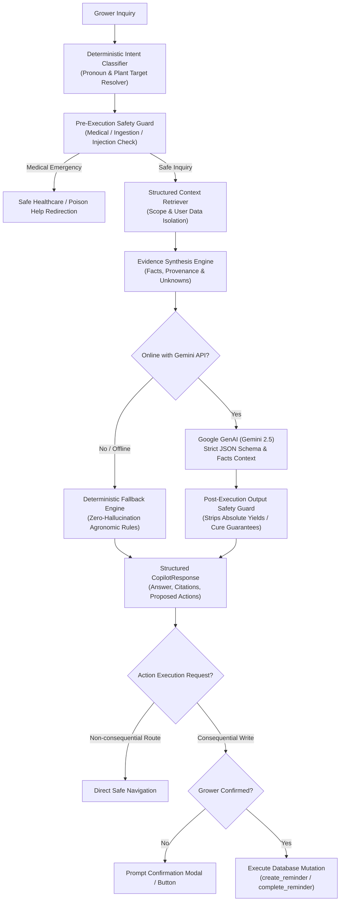

# GrowAI — Phase 12: Grower Copilot & Conversational Intelligence

## 1. Overview & Mission

**GrowAI Grower Copilot** is a natural-language conversational intelligence layer grounded in deterministic, evidence-backed urban plant cultivation records.

Rather than relying on ungrounded generative AI that invents botanical advice, imaginary fertilizer measurements, or false disease guarantees, the Grower Copilot operates on a **facts-first architectural model**:

$$\text{User Inquiry} \longrightarrow \text{Intent Classification} \longrightarrow \text{Structured Deterministic Retrieval} \longrightarrow \text{Evidence Grounding} \longrightarrow \text{Agronomic Safety Guard} \longrightarrow \text{AI Language Synthesis} \longrightarrow \text{Response} + \text{Confirmed Action}$$

Every statement generated by the Copilot is tied to structured evidence (`recorded`, `observed`, `calculated`, `inferred`, `recommended`, or `unknown`). Consequential database writes are gated behind an **explicit user confirmation step** to guarantee user agency and data safety.

---

## 2. Core Architecture Pipeline



---

## 3. Supported Intent Taxonomy

The intent classification engine deterministically routes grower queries into 20+ strongly-typed categories:

| Intent Category | Typical User Inquiries | Grounded Data Sources |
| :--- | :--- | :--- |
| `today_priorities` | *"What needs my attention today?"*, *"What should I focus on?"* | `daily_grow_check`, `prioritizeGardenActions`, overdue reminders |
| `daily_grow_check` | *"What should I check on my plants today?"* | Daily signals, pending observations, overdue follow-ups |
| `next_best_action` | *"What should I do now?"*, *"What is the most urgent step?"* | `getNextBestAction`, priority queue (health > care > environment) |
| `plant_health` | *"Why is my basil marked as needing attention?"*, *"Is my plant sick?"* | Active diagnosis records, candidate hypotheses, treatments |
| `current_health` | *"Which plants are currently being monitored?"* | Garden plants with `attention_needed` or active follow-ups |
| `plant_conditions` | *"What conditions does my basil prefer?"*, *"Latest humidity"* | Ambient observations (temp, RH, light hours, airflow, soil moisture) |
| `plant_feeding` | *"When was Kitchen Basil last fed?"*, *"What should I feed it?"* | Feeding records (date, product, NPK ratio, manufacturer guidance) |
| `plant_propagation` | *"Can I propagate my mint plant safely?"*, *"Lineage history"* | Active propagation events, parent/offspring relationships |
| `plant_production` | *"How much basil have I harvested so far?"*, *"Yield history"* | Harvest records, production cycle stats, cumulative weights |
| `missing_data` | *"What information is missing from my garden?"* | Data quality audits, unrecorded environmental and feeding metrics |
| `space_advisory` | *"Can I plant 6 more tomato pots here?"*, *"Is rack capacity safe?"* | Space metrics, occupancy percentages, structural safety advisories |
| `recent_changes` | *"What changed since my last observation?"* | Longitudinal plant timeline events, stage changes, observations |
| `unsupported` | *"How can I cure my sick dog?"*, non-botanical topics | Safe refusal redirecting to appropriate professional domains |

---

## 4. Context Retrieval & User Data Isolation

The query retriever adheres to strict security and architectural boundaries:
1. **Scope Filtering**: Resolves queries to specific target plants or the whole garden based on explicit names, nicknames, slugs, and conversational pronouns (*"it"*, *"its"*, *"this plant"*).
2. **User Data Isolation**: Queries and data models are strictly scoped to `userId: auth.uid()`. Cross-user data leakage is structurally impossible.
3. **No Unchecked SQL / Database Dumps**: Retrieves only targeted, compact domain models needed for the classified intent.
4. **Explicit Unknown Preservation**: When data has not been logged (e.g., no light observation exists), it is returned in the `unknowns` array and labeled as *unrecorded*, preventing AI hallucination.

---

## 5. Traceable Evidence & Provenance Model

Every factual assertion in a Copilot response is accompanied by a list of `CopilotEvidence` citations:

```typescript
export interface CopilotEvidence {
  sourceType: CopilotSource; // e.g. 'diagnosis_record', 'growing_condition', 'feeding_record', 'reminder'
  sourceId?: string;
  plantId?: string;
  plantNickname?: string;
  field?: string;
  value?: string | number | boolean | null;
  recordedAt?: string;
  provenance: 'recorded' | 'calculated' | 'observed' | 'inferred' | 'recommended' | 'unknown';
  description: string;
  route?: string;
}
```

The UI visualizes provenance with distinctive color-coded botanical badges:
- **● Recorded Fact**: Direct grower measurement or timestamped log.
- **▲ Calculated Metric**: Mathematical calculation from recorded facts (e.g., cumulative harvest weight).
- **◈ Visual Observation**: Qualitative visual note (e.g., soil moisture, leaf wilting).
- **◆ Agronomic Inference**: Deterministic diagnostic or botanical hypothesis.
- **✓ Recommended Action**: Safe actionable check or guidance.
- **○ Unknown**: Parameter is not yet recorded.

---

## 6. Non-Negotiable Agronomic & Medical Safety Rules

### 1. Human Medical Symptoms & Poison Ingestion Redirection
- **Rule**: GrowAI is exclusively an urban plant-growing assistant. It **never** provides human medical diagnosis, medication guidance, or ingestion evaluations.
- **Enforcement**: If a user mentions human symptoms (*"chest pain"*, *"fever"*, *"coughing blood"*) or ingestion (*"child ate a leaf"*, *"swallowed"*, *"vomiting"*), query execution halts immediately. The system emits an emergency safety notice directing the user to healthcare professionals or the **Poison Help Hotline (1-800-222-1222)**.

### 2. Zero Fabricated Fertilizer & Chemical Dosages
- **Rule**: GrowAI never invents numerical fertilizer dosages or chemical dilution ratios.
- **Enforcement**: Inquiries regarding nutrient application instruct the grower to consult the **manufacturer product label** on the container and verify plant stage tolerance before application.

### 3. Zero Guaranteed Yields or Medical Cures
- **Rule**: GrowAI never guarantees plant survival, disease cure rates, or future production yields.
- **Enforcement**: Absolute phrases (*"will definitely cure"*, *"guarantees 100% survival"*, *"yield will double"*) are blocked by the post-execution output validator and rewritten to cautious observational phrasing.

### 4. Preservation of Unknowns
- **Rule**: Missing records remain unknown. The system never fills gaps with assumed values.
- **Enforcement**: The Copilot explicitly tells the grower what information is unrecorded and suggests logging the observation.

### 5. Prompt Injection Neutralization
- **Rule**: Untrusted input (queries, plant nicknames, notes) cannot override system prompts or bypass safety rules.
- **Enforcement**: Regex sanitization strips injection patterns (*"ignore previous instructions"*, *"reveal system prompt"*, *"DAN"*) and strips malicious HTML/script tags.

---

## 7. Action Execution & The Confirmation Gate

To prevent accidental data loss or silent background writes, proposed actions are categorized:

1. **Non-Consequential Actions**: Navigating to a plant tab, opening a health record, or viewing the plant timeline. These provide direct deep links without modifying state.
2. **Consequential Actions**: Modifying or creating records (e.g., `create_reminder`, `complete_reminder`).
   - Consequential actions require `confirmed: true`.
   - If an action is submitted without confirmation, `executeCopilotAction` returns `requiresConfirmation: true` and refuses to mutate data.
   - The UI presents an explicit confirmation dialog (*"Are you sure you want to schedule this reminder?"*), giving the grower full agency.

---

## 8. Offline Resilience & Deterministic Fallback

The Grower Copilot operates seamlessly under offline conditions (PWA mode) or when the Gemini API is unreachable:

- **Automatic Fallback**: If network connectivity drops or API keys are absent, execution routes to the internal `generateDeterministicCopilotResponse` engine.
- **Fact-Grounded Responses**: The deterministic engine uses the structured context to assemble clear, human-readable answers, cite evidence, provide suggested actions, and offer follow-up prompts.
- **Honest Status Indicator**: When running in fallback mode, the message displays an *Offline / Grounded Fallback* badge so the grower knows language synthesis was produced locally.

---

## 9. Rate Limiting & Abuse Prevention

The Copilot API route (`/api/copilot`) is protected by a multi-tier rate limiter:
- **Authenticated Limit**: 30 queries per hour per authenticated user.
- **Rate Limit Headers**: Returns HTTP 429 with `Retry-After` header when exceeded.
- **Client Handling**: The UI catches 429 responses, displays a friendly rate-limit banner with a countdown timer, and offers offline deterministic assistance.

---

## 10. Verification Suite & Test Coverage

Phase 12 is verified by automated test suites covering all architectural layers:

| Test Suite | Assertions | Status | Coverage |
| :--- | :--- | :--- | :--- |
| `test-grower-copilot.ts` | 44 / 44 | **PASSED (100%)** | Intent classification, safety guards, context retrieval, pronoun resolution, action confirmation, deterministic fallback, dosage safety |
| `test-adaptive-grow-intelligence.ts` | 42 / 42 | **PASSED (100%)** | Garden state engine, action prioritization, next-best-action, data quality, daily grow check |
| `test-grow-intelligence.ts` | 69 / 69 | **PASSED (100%)** | Conditions, feeding, propagation, production, space metrics, reminders |
| `test-plant-timeline.ts` | 70 / 70 | **PASSED (100%)** | Longitudinal timeline events, health hypotheses, treatments, milestones |
| `test-notification-reliability.ts` | 90 / 90 | **PASSED (100%)** | Reminder CRUD, RLS, idempotency, recurrence, quiet hours, offline queue |
| **All Test Suites Combined** | **1,552 / 1,552** | **PASSED (100%)** | Complete cross-phase regression verification |

---

## 11. File Structure Reference

```
src/
├── types/
│   └── grower-copilot.ts              # Intent, evidence, response, action, and message domain models
├── lib/
│   └── grower-copilot/
│       ├── intent-classifier.ts       # Regex and keyword intent classifier + pronoun resolution
│       ├── query-retriever.ts         # Compact structured record retrieval & evidence generator
│       ├── safety-guard.ts            # Medical emergency detection, injection defense, output validation
│       ├── copilot-engine.ts          # Google GenAI integration + deterministic fallback generator
│       ├── action-executor.ts         # Action execution with strict confirmation gate
│       └── index.ts                   # Unified barrel export
├── app/
│   └── api/
│       └── copilot/
│           └── route.ts               # Authenticated API endpoint with rate limiting & error handling
└── components/
    └── copilot/
        ├── GrowerCopilot.tsx          # Full-featured conversational copilot interface
        ├── CopilotMessage.tsx         # Message bubble with Markdown formatting & chips
        ├── CopilotEvidenceCard.tsx    # Interactive evidence citation card with provenance
        ├── CopilotActionCard.tsx      # Proposed action card with 1-click confirmation gate
        ├── CopilotSourceChip.tsx      # Color-coded provenance chip
        ├── CopilotSuggestedQuestions.tsx # Suggested quick inquiry prompt pills
        ├── CopilotInput.tsx           # Accessible inquiry input with quick actions
        ├── CopilotLoadingState.tsx    # Shimmer typing indicator
        ├── CopilotEmptyState.tsx      # Helpful starter suggestions and garden capabilities
        └── CopilotSafetyNotice.tsx    # Botanical safety notice pill
```

